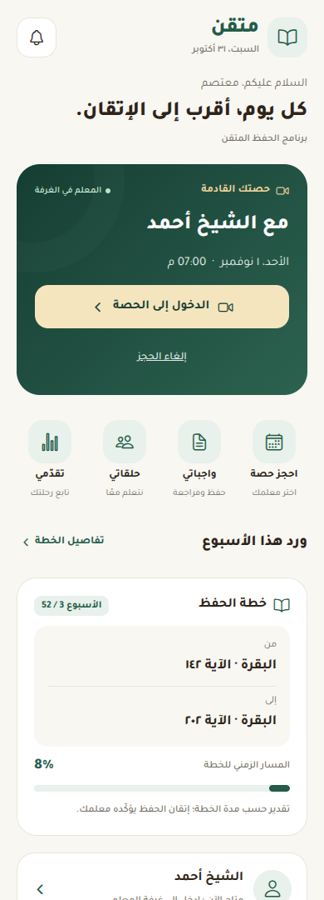
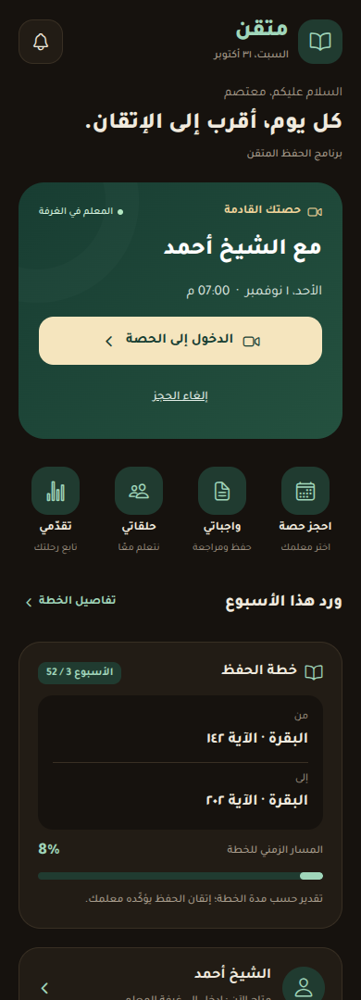
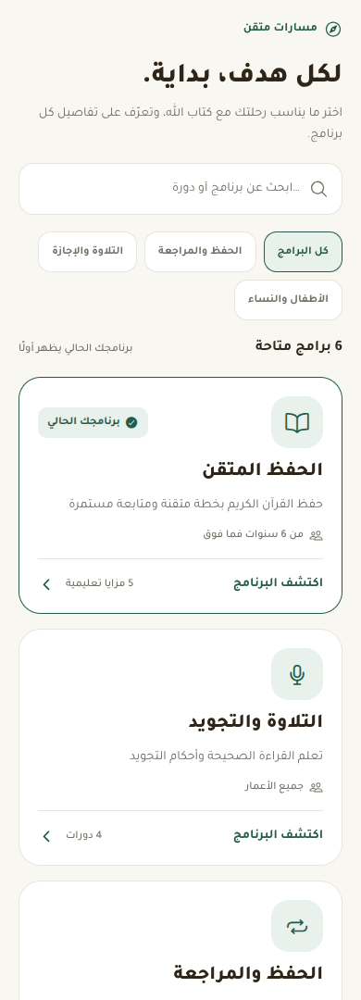
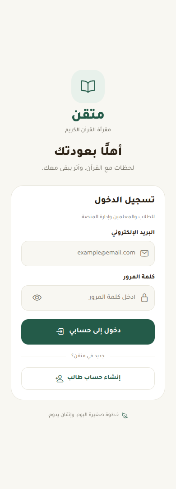

# تحسين واجهات تطبيق متقن

هذه مراجعة أولى لتجربة الطالب في تطبيق Expo، وتشمل الرئيسية والبرامج والدخول والحجز وشريط التنقل. لم تُنشر كتحديث للمستخدمين.

## ما تغيّر

- تقديم الحصة القادمة وإجراء الدخول إليها، مع إبقاء الإلغاء بتأكيد منفصل وإظهار فشل الإلغاء.
- جمع اختصارات الحجز والواجبات والحلقات والتقارير، والإبقاء على الوصول للاختبارات والشهادات والأرشيف والإعلانات.
- عرض **ورد الأسبوع** بدل وصف المقدار الأسبوعي بأنه «ورد اليوم».
- تسمية مؤشر الخطة بأنه مسار زمني، وتوضيح أن مرور الأسابيع لا يثبت إتقان الحفظ. انتهاء المدة يدعو لمراجعة المعلم بدل إعلان إتمام الحفظ.
- سحب لتحديث الرئيسية، وهيكل تحميل، ورسالة تعذّر الاتصال مع إعادة المحاولة. فشل قراءة الملف أو الحجوزات لا يتحول إلى حالة حساب فارغ.
- البحث عن البرامج وأسماء دوراتها، مع تجاهل التشكيل واختلافات الهمزة، وتصنيف البرامج وحالة عدم وجود نتائج.
- شاشة دخول قابلة للتمرير مع لوحة المفاتيح، وإظهار كلمة المرور وإخفائها، وتسلسل حقول الإدخال ورسائل خطأ أوضح.
- دعم ألوان فاتحة وداكنة، وتباعد وخطوط أوضح، وتسميات لقارئ الشاشة في العناصر الجديدة، ومراعاة الحافة السفلية في شريط التنقل.
- توضيح السعر والدفع قبل تأكيد الحجز. الاختيار المؤقت هو مهلة مراجعة محلية؛ الموعد لا يُحجز في قاعدة البيانات حتى التأكيد.
- تعطيل الأوقات حتى تحميل توفرها، ومنع تغيير الموعد أثناء التأكيد، وإعادة تفعيل الواجهة عند فشل الاتصال. فشل تحديث رقم التواصل بعد إنشاء الحجز لا يحوّل الحجز الناجح إلى رسالة فشل.

## المعاينات

الصور معاينات للمكونات الفعلية عبر React Native Web ببيانات وخدمات اختبار بديلة، وليست لقطات من هاتف أو من حسابات حقيقية. شريط تنقل Expo الأصلي غير معروض في الصور. لم تُضف خدمات الاختبار أو اعتماديات المعاينة إلى التطبيق.

| الرئيسية | الوضع الليلي |
| --- | --- |
|  |  |

| البرامج | تسجيل الدخول |
| --- | --- |
|  |  |

## التحقق

- نجح `npx tsc --noEmit`.
- نجح `npx expo export --platform android` في تجميع جميع المسارات إلى حزمة Hermes؛ هذا ليس بناء APK أو AAB.
- نجح فحص التنسيق `git diff --check`.
- نجحت اختبارات واجهة بمعاينة React Native Web: روابط الرئيسية، استدعاء إجراء الإلغاء، حالات التحميل والخطأ والحساب الجديد، الوضع الليلي، البحث والتصفية ومسح النتائج، التحقق من حقول الدخول وإظهار كلمة المرور ورفض بيانات دخول غير صحيحة.
- نجحت سيناريوهات الحجز بخدمات بديلة: التأكيد، تعارض الموعد، واستعادة زر التأكيد بعد فشل الشبكة. لم يُنشأ أي حجز حقيقي.
- لم يظهر تجاوز أفقي في المقاسات 320 و390 و768 بكسل للشاشات المختبرة، ولم تظهر أخطاء تشغيل في المتصفح.
- فحص ESLint بإعداد Expo الافتراضي: الملفات الأساسية الجديدة والمعدلة للواجهة دون أخطاء أو تحذيرات. الفحص العام يحتوي على مخالفات سابقة في ملفات أخرى وفي معالج اختيار الوقت بالحجز؛ المقارنة مع الفرع الأصلي لم تظهر مخالفات جديدة. لم تُضف اعتماديات أو إعدادات lint إلى هذا التعديل.

قبل النشر، تُراجع نسخة تطوير على هاتف Android وiOS: لوحة المفاتيح، تكبير النص، قارئ الشاشة، الحواف الآمنة، الدخول بالحسابات الحقيقية، ثم الحجز والدفع وغرف الفيديو. لم تُختبر اتصالات Supabase الحية أو الكاميرا والميكروفون في هذه المراجعة.
